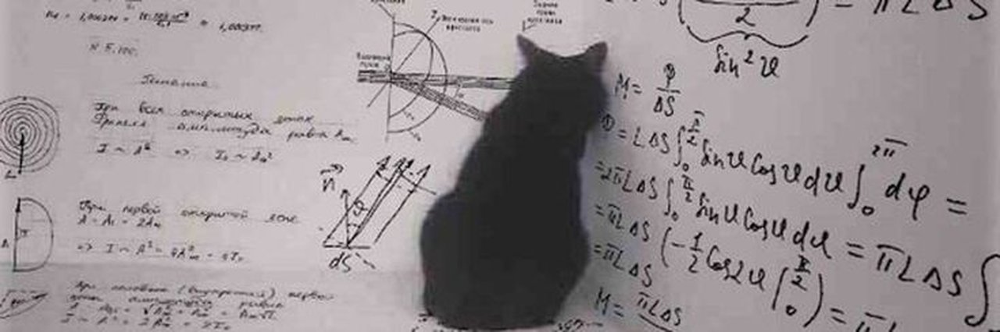

# Hi, I am Saksham Chauhan

### First-Year B.Tech Student

### Maths • Physics • AI • Machine Learning • DSA • Web Dev

---

### About Me

<table>
<tr>
<td width="40%" valign="top">

**Saksham, here** — a first-year B.Tech student.

I enjoy exploring **maths** and **physics**, and applying them through **AI**, **machine learning**, **DSA** and **web development** — learning how things work from first principles, and then building with them.

Right now, I'm focused on strengthening my fundamentals — problem-solving through DSA, understanding core maths and physics concepts deeply, and turning what I learn into small, working web projects.

I'm curious by nature. I like breaking a hard problem into smaller parts, understanding the logic behind it, and then building a clean, simple solution for it.

My goal is simple: learn deeply, write clean code, and grow into a software engineer who creates things that last.

</td>
<td width="60%" valign="top">

<pre>
====================================================================================================
=+==++======+======+=====================++====+***++==++++==============================+===+======
+=============+=+===============+==+==++++=++#@*. .-:=+-:-+***++====++=====+========================
================+============+===++++++=--=+=-.:*+#@%@@#-:. .=+**++===++=====+==============+=======
==+======================++====+++++=-::::::=@@@@%%*%*=*%@%=   .-+*++==============+==+=============
==+=+++++++=+================+++++=:.:.  :-+@#:     ==    .=+:    :=*++=============================
=====++=+===+=============++++++-..::  ++=-+=  .=@::+*=-..   ..     .=*+++===========+===+=+=++==+==
======+====++======+=++==++++*+:..:.  ---:..   .*@::+-:..    .  .     :+*+==========================
+==================+===++++++-....  :=-.       .:*:   :                 =*++========================
====+==+=========+====++++++: ...              .:+=.                  .  :+++++====+================
++=+====++++++===++++=++=+*:  .:        ..::----:--..:..               .  :++++=========++=====+====
++++==========+===++++=+++:  .:    .---=+#%%%@@%#****##*++-:               .++++++====++=+==========
+++===========+====+++=+=:.  :     :-=*%@@%%%%#######***##%#*==.            .=++======++====++==++==
++++=====++++++++++++==+:.  :.     :+@@@%%%%%#####*###*#****++#%%-           :++++++==++=======+++====
++++=+==+++++++++++=+=+-.. .:      :*%%#####%%%#########***++++*+.           :++++++==++=======+===
+==+=+++++=++=++++++=+-:. .:      :%@@@@@@@@@@%%%####%%%@@@@@@@@%#+.       .   -=+++++=====+========
++++++++++++=++++++++=:.  :       ##+%%#****#%@%###%%##*+-:...::-.::           .-=++=+===+=========+
++++=====+++++++++++=-:. .:      .+-==-.     .-+#####+-... ....:-=-.            :-+++=++===++=====++
++++++++++=++++++++==-:. ..       *%@@%#+==--+**##*+++++=----:--==::.           .-=++++++=+++++==+++
+++++++=+++++++++++=-:. :.       ::.. .-      -%%@#*-.. .-   .   .  .           :==+++++++=+++===++
++++++==++++++++++===:. ..:    .. .*%#++@- -=.: .%@%* .---+:=+=.-==:             .-=++++++++++======
+++++++++++++=+++++==:::.  :     .-%%%%#+**==+@@ =#%- *==::-+==+*##:+            .:=+++++++==++=====
+++++++++++++++++++==--:     :.   -:@@@@@%%%%@@@%=#@@#==+*#***##%%#.:=           ...+++++==++++======
++++++++++++++++++==.     .   .   -%@@@@%@@%%*#=+@@##*-+++***##**+:*:             +++=++==+++==++===
+++++++++++++++++++-:. .   .       @@@@@@%###*+%@@@##%#-+###*****=:             -++++=++==++++=====+
+++++++=++++++++++++:. :.   .      *@@@@@%%%*=#@*#@%*+*%+=*****+=::+.          -++++++=+++++=======+
+++++++++++++++++++*+= ::           @@@@@@%#*##++#+=*-:-+++**###%%@@          .=+++++++++=++++++====
++++++++++++++++++++*+-:            +@@@@@%%%@@@%#==*=+*#%#****###@.          =+=+++++++++==+++==++=
+++++++++++++++++++++++:             *@@@@#+-:::..::.......=+*##%@:            -***++++++++++++++++=
+++++++++++++++++++++++=....           :@@%#*%@%**+---=::-=++***#%.           -   .-+++++++++++++=+++
+++++++++++++++++++++++=.::..            %@@@%%%#*+===+++**+**##+             :#%+=+++++++++++++++=++
++++++++++++++++++++++*:......          .=#@@@%%###*++++++*#*=:                -**+++++++++++++++=++
+++++++++++++++++++++=-...       .      :::=*@@@@@#%%###%%*-:::                  :++++++++++++++++++
++++++++++++++++++++++=:.                -==--=*##**##*+=---==:                .-++=++++++++=+++++++
++++++++++++++++++=-.                     :=**++++===----=++=-               ..  .:=++++++++++++++++
+++++++++++++++++++-    .                 .:+*####***++++*+==.                :+**=--+++++++++++++=+
+++++++++++++==++***-.     ..              +*####*******+++=:                      .++++++++++++++++
++++++++++***#####*+=:. ..-:            -*. =**####*******+-:  :*               .-*@%#**++++===+++++
+***#####*++=-:..        .             .#@@+.:++++**++++++-   =@@                  .-=+*######**++++
+#*+=::.                              ..:#@@@-:=+++++++*+:  -@@@%=                        ..:==**##+
.                                     -@@@@@@@#-=******#+:-@@@@@@@.                               .:
   ....                               .@@@@@@@@@*+***##+=#@@@@@@@%                          ..
                     .                 .@@@@@@@@@@@*+*+*@@@@@@@@@%*.
                                       .@@@@@@@@=+#@@@@@+:--@@@@@@@.
                                        @@@@@#    ..  :-.    .@@@@@
                                        @@@@:           .=-    #@@@
                                        @@:#=#@*:.:.       .**+*.@@
                                           *@@@@@%:-%+.   .@@@@@  :
                                         -.  @@@@@%  :+= =@@@@@  .
                                          :+  +@@@@:    -@%@@+  =.
                                            #:  @@=   .+ *@@   *
                                             -#     .#*   +  ==
                                               -:   -.     .-
</pre>

</td>
</tr>
</table>

---

### Connect

---

### Tech Stack

---

### GitHub Stats

---

### Activity Graph

